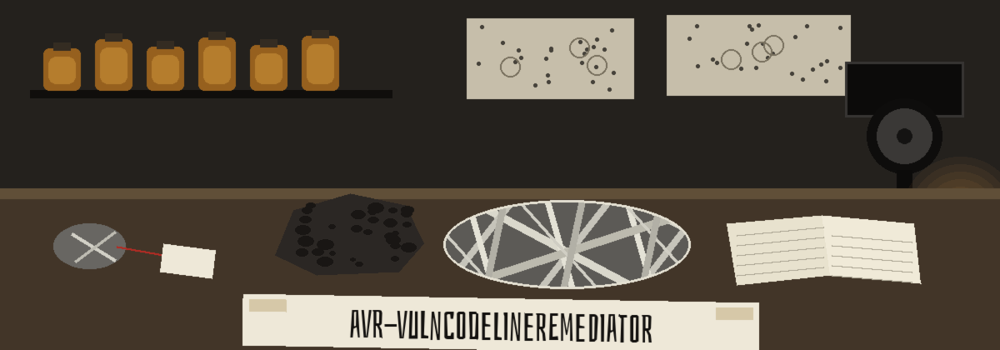
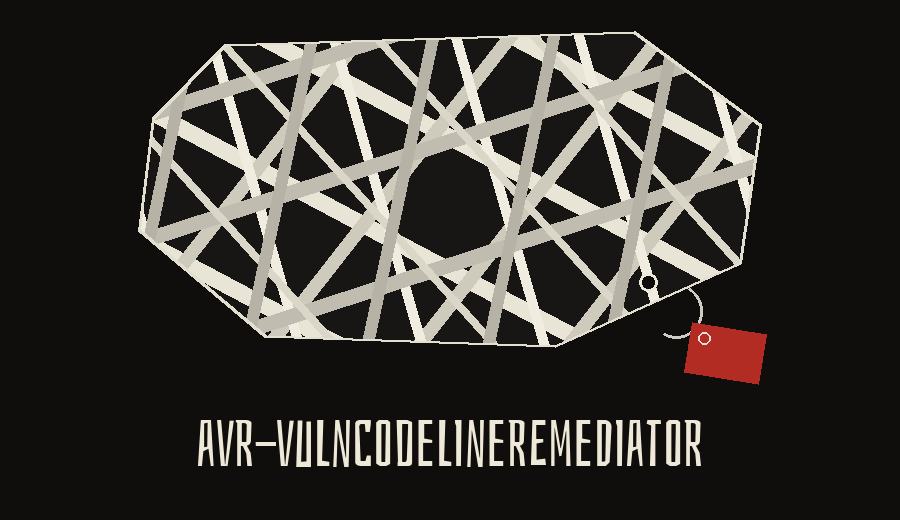

# avr-VulnCodeLineRemediator

Given a known vulnerability and a codebase, this tool scans for the lines that may need remediation and writes a patch file for them. The scan is a keyword line scan over Python files that parse (`ast.parse` is used only to confirm a file parses, not to match blocks): it fetches the search page for the vulnerability ID from the database base URL given, takes the text of the first cell of the first table on that page as the description, splits that text into keywords, and lists every line containing one of those keywords. A default run changes no scanned file; it only writes the patch file. Passing `--apply` applies the code changing patches in place, per file from the highest line number down. Suggestions that only add a comment, such as the `os.system` and `pickle.load` warnings, change no code, so they are written to the patch file as manual steps, are never auto applied, and are logged as manual steps, not as applied fixes.

> **Amber jar: a default run changes no scanned file.** It only writes the patch file. Passing `--apply` is the step that changes code, per file from the highest line number down.

> **Amber jar: comment only means by hand.** Suggestions that only add a comment, such as the `os.system` and `pickle.load` warnings, are written to the patch file as manual steps, are never auto applied, and are logged as manual steps, not as applied fixes.

## Install
`git clone https://github.com/ShadowStrikeHQ/avr-vulncodelineremediator`

## Usage
`./avr-vulncodelineremediator [params]`

## Parameters
- `-h`: Show help message and exit
- `--vulnerability_id`: No description provided
- `--codebase_path`: The path to the codebase to scan.
- `--output_patch_path`: The path to save the generated patch file. Defaults to 
- `--apply`: Apply code changing patches to the files in place. Without this flag a run only writes the patch file and changes no scanned file. Comment only suggestions are never applied; they appear in the patch file as manual steps.
- `--approval_required`: With `--apply`, ask before applying each patch. Has no effect without `--apply`.
- `--exploit_db_url`: The base URL of the Exploit Database to use for vulnerability information.

## License
Copyright (c) ShadowStrikeHQ
